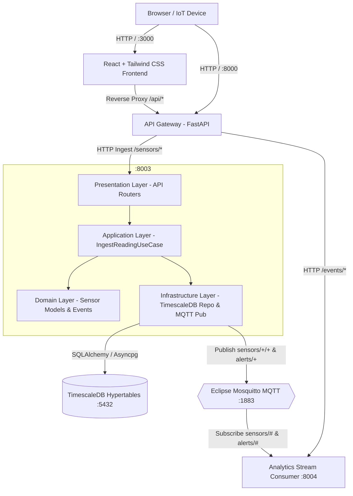

# 🚀 Event-Driven Layered Microservices Boilerplate
### **React 19 + Tailwind CSS v4 • FastAPI • Eclipse Mosquitto (MQTT) • TimescaleDB**

---

## 🏗️ Architecture Design

This project implements an **Event-Driven, Layered Architecture** for high-throughput time-series ingestion, asynchronous domain events, and real-time streaming:



---

## 🏛️ Layered Architecture Details

The **Sensor Microservice** ([`backend/services/sensor_service/`](file:///home/saran/projects/TCS_Hackathon/backend/services/sensor_service)) demonstrates clean unidirectional layered architecture:

```
backend/services/sensor_service/
├── presentation/               # Layer 1: HTTP API Routers & Controllers
│   └── api/router.py           # Ingestion endpoints & Timescale query routes
├── application/                # Layer 2: Application Use Cases
│   └── use_cases/ingest_reading.py # Validates, saves to DB, triggers MQTT event & checks anomalies
├── domain/                     # Layer 3: Core Business Models & Invariants
│   └── models/sensor.py        # SensorReadingDomain & Event definitions
└── infrastructure/             # Layer 4: External adapters & drivers
    ├── repositories/
    │   ├── models.py           # TimescaleDB hypertable schema
    │   └── sensor_repo.py      # Hypertables initialization & time_bucket analytical SQL
    └── events/
        └── publisher.py        # MQTT topic publisher
```

---

## ⚡ Event-Driven Capabilities

1. **MQTT Event Topics**:
   - `sensors/{device_id}/{metric}`: Broadcasts telemetry when readings are ingested.
   - `alerts/sensors/{device_id}`: Broadcasts anomaly alerts (e.g. Temperature > 85°C, Pressure > 120 PSI).
2. **Asynchronous Consumer Worker**:
   - [`backend/services/analytics_consumer/main.py`](file:///home/saran/projects/TCS_Hackathon/backend/services/analytics_consumer/main.py) runs an MQTT subscriber listening to `sensors/#` and `alerts/#` concurrently.
3. **TimescaleDB Time-Series Optimization**:
   - Uses `create_hypertable('sensor_telemetry', 'timestamp')` for automated partitioning.
   - Computes continuous aggregated metrics using Timescale SQL: `time_bucket('1 minute', timestamp)`.

---

## 📁 Project Directory Tree

```
├── docker-compose.yml              # Multi-container orchestration (MQTT + TimescaleDB)
├── .env.example                    # Environment variable template
├── scripts/
│   └── start.sh                    # Helper startup script
├── frontend/                       # React 19 + Tailwind CSS Frontend
│   ├── src/
│   │   ├── App.jsx                 # Live MQTT stream, TimescaleDB analytics & architecture inspector
│   │   ├── index.css               # Tailwind CSS v4 setup & glassmorphism tokens
│   │   └── main.jsx
│   ├── Dockerfile                  # Multi-stage production Nginx build
│   ├── nginx.conf                  # Nginx proxy config
│   ├── package.json
│   └── vite.config.js
└── backend/
    ├── requirements.txt            # Python async dependencies (FastAPI, paho-mqtt, asyncpg)
    ├── Dockerfile                  # Container definition for FastAPI services
    ├── common/
    │   └── database.py             # SQLAlchemy Async Engine with TimescaleDB initializer
    ├── mosquitto/
    │   └── config/mosquitto.conf   # Eclipse Mosquitto configuration (ports 1883 & 9001)
    ├── gateway/                    # API Gateway (Port 8000)
    │   └── app/main.py
    └── services/
        ├── event_bus/              # Shared MQTT Event Bus client
        │   └── mqtt_bus.py
        ├── sensor_service/         # Layered Sensor Service (Port 8003)
        │   ├── presentation/
        │   ├── application/
        │   ├── domain/
        │   └── infrastructure/
        ├── analytics_consumer/     # Event Consumer Worker (Port 8004)
        │   └── main.py
        ├── user_service/           # User Domain (Port 8001)
        └── product_service/        # Product Domain (Port 8002)
```

---

---

# ❄️ PS 3.2: AI-Powered AC Usage Optimization (Campus Closed Loop)

A complete closed-loop energy optimization prototype for campus Air Conditioner units:
```
Sense -> Ingest -> Understand (Counterfactual Baseline + Waste Classification) 
      -> Predict -> Optimize -> LLM Proposes -> Rule Engine Validates 
      -> Human Approves -> Command Service Acts -> Verify Savings Range
```

## 📐 Architecture Diagram

```
+-----------------------------------------------------------------------------------+
| SIMULATOR & TELEMETRY INGESTION (Speed Multiplier 60x)                           |
|  - SyntheticProvider (Diurnal solar temp, timetable enrollment, noisy CV headcount)|
|  - Injects labelled anomalies into ground_truth_labels table                     |
|  - Actuators respond to MQTT cmd/# and emit cmd_ack/#                             |
+-----------------------------------------+-----------------------------------------+
                                          | MQTT: telemetry/#, occupancy/#
                                          v
+-----------------------------------------------------------------------------------+
| TIMESCALEDB & INTELLIGENCE MODULE (FastAPI :8003 / Gateway :8000)                |
|  - SeasonalGradientBoostingBaseline: Predicts counterfactual expected kW with +/- |
|  - WasteClassifier: Residuals -> after_hours, ghost_cooling, overcooling, etc.   |
|  - Forecaster: 7-day and 4-week load intervals with weather/timetable drivers    |
|  - Optimizer: Solves comfort band, pre-cooling lead times, and flywheel shut-off  |
|  - SavingsEngine: Measures verified post-action savings reported as ranges        |
+-----------------------------------------+-----------------------------------------+
                                          |
                                          v
+-----------------------------------------------------------------------------------+
| SAFETY-CRITICAL GOVERNANCE & CONTROL LOOP                                         |
|  1. LLM Agent: Read-only inspection tools + create_proposal (Mock offline mode)   |
|  2. Rule Engine: Deterministic comfort bands, rate limits, server room safety     |
|  3. Operator Approvals Inbox: One-click approve or reject                         |
|  4. Command Service: ONLY component with MQTT broker write access (with expiry)   |
+-----------------------------------------+-----------------------------------------+
                                          |
                                          v
+-----------------------------------------------------------------------------------+
| APPLE-GRADE REACT 19 FROSTLINE DASHBOARD (:3000)                                  |
|  - Light / Dark / System themes (SF Pro typography, frosted glass, zero flash)   |
|  - 8 Bespoke Screens: Campus Overview, Room Detail, Waste Events, Forecast,       |
|    Optimizer & Schedules, Approvals Inbox, Assistant, Simulator & Evaluation      |
|  - Design System Tokens: Located in `frontend/src/tokens.css`                     |
|  - Theme Switch: Persisted via localStorage (`theme_preference`), respects        |
|    `prefers-color-scheme`, toggle between Light / Dark / System in top bar        |
+-----------------------------------------------------------------------------------+
```

---

## 🚀 Running the Stack & Running the Demo

### 1. Start Services
```bash
docker compose up --build -d
```
All 15 campus rooms across 3 buildings (Engineering, Science, Administration) are automatically seeded on startup.

### 2. Run the Closed-Loop Demo Scenario
1. Open the UI at [http://localhost:3000](http://localhost:3000).
2. Click the top-bar button **"Run Demo Scenario"**.
3. Watch the end-to-end loop:
   - Injects `ghost_cooling` anomaly into Lecture Hall 101.
   - Waste classifier identifies the waste event and calculates INR tariff cost.
   - Copilot creates a remediation proposal relaxing setpoint to 25.5°C.
   - Rule Engine validates comfort band invariants (`PASSED`).
   - Operator approves proposal.
   - Command Service dispatches command to MQTT broker (`cmd/eng-101/ac-eng-101-1`).
   - Simulated AC applies setpoint, power drops, and verified savings range (e.g. ₹128.0 - ₹176.5) is logged.

### 3. Run Backend Tests
```bash
PYTHONPATH=backend backend/.venv/bin/pytest backend/tests/
```

---

## 🔄 Swapping in Real Model & Dataset (Zero Caller Changes)

Refer to [`backend/intelligence/adapters/README.md`](file:///home/saran/projects/TCS_Hackathon/backend/intelligence/adapters/README.md) for full instructions:
- **Drop-in Trained Model**: Place weights in `backend/intelligence/adapters/model_artifacts/` and configure `BASELINE_MODEL=custom`.
- **Drop-in ASHRAE GEPIII Data**: Place `train.csv` (meter=1) and `weather_train.csv` in `backend/intelligence/adapters/ashrae_data/` and configure `DATASET_PROVIDER=ashrae`.

---

## ⚖️ Honest Limitations & Design Assumptions

- **Synthetic Room Data**: Room-level telemetry and CV headcounts are generated with diurnal 2R2C lumped-capacitance physics and Gaussian sensor noise; no physical IoT hardware or optical cameras are deployed.
- **ASHRAE Scale & Site Offset**: The ASHRAE GEPIII dataset supplies whole-building chilled water meters, normalized and scaled down to room-level zones. The `-8h` weather shift is an `ASSUMPTION` about the site's local time zone offset (Arizona MST/PDT), which aligns empirical station weather peaks with afternoon diurnal cooling peaks.
- **Anomaly Counts & Waste Share**: The energy waste share (~34.7%) and anomaly event counts (28 per anomaly type, 12-14 per decoy type) are **injection policy settings** configured in `config/anomalies.yaml`, NOT measured baseline field waste in a real campus.
- **Setpoint Savings Heuristic**: A 4.0% power reduction per 1°C setpoint elevation is an optimizer default heuristic (`ASSUMPTION`). The simulated physical 2R2C thermal physics engine yields a room-type dependent elasticity distribution ranging between 2.64% and 6.15% per °C (median 4.60% per °C for status `ok` rooms).
- **Kafka / Redis**: Mosquitto MQTT and PostgreSQL/TimescaleDB satisfy real-time message brokering and time-series persistence for the prototype without the overhead of Kafka clusters.


